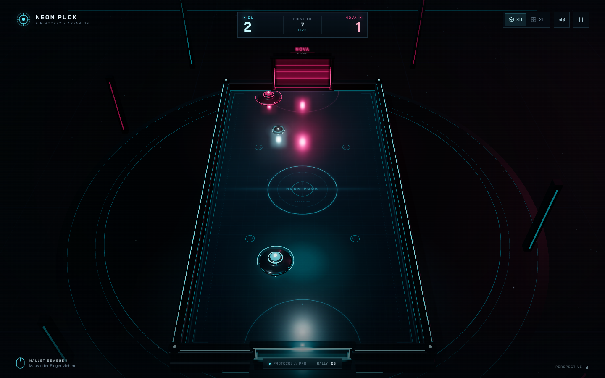
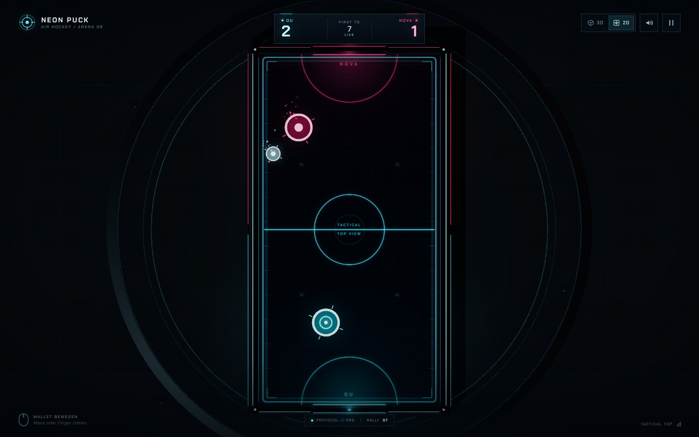

# NEON PUCK

**Holografisches Airhockey im Browser — 3D-Perspektive, 2D-Taktikansicht und ein adaptiver KI-Gegner.**

NEON PUCK ist ein vollständig im Browser laufendes Airhockey-Spiel. Die komplette Arena,
die Effekte und der Sound werden prozedural erzeugt — es gibt keine externen Laufzeit-Abhängigkeiten
und keine Build-Pipeline.



## Features

- **Zwei Ansichten** — cineastische 3D-Perspektive und eine eigens gestaltete 2D-Top-Down-Taktikansicht.
  Umschalten mit `V` oder über den 3D/2D-Schalter.
- **KI-Gegner NOVA** — drei Protokolle (Rookie, Pro, Legend) mit unterschiedlicher Reaktion,
  Laufgeschwindigkeit, Winkelabdeckung und Zielgenauigkeit. NOVA liest Schüsse, verteidigt das Tor
  und kontert in die offene Ecke.
- **Arcade-Physik** — elastische Banden, Torkreuz-Pfosten, Mallet-Impulse, Puck-Reibung,
  Geschwindigkeitsbegrenzung und ein fester 240-Hz-Physikschritt.
- **Match-Flow** — erster bis 7, Countdown, Torjubel, Pause, Rematch und Ergebnisstatistik
  (Spielzeit, Top-Speed, längste Rally, Mallet-Hits).
- **Atmosphäre** — Bloom, Partikel, Schockwellen, prozedurale Skyline, Neonportal, adaptives Licht,
  Soundtrack und Effekte über die Web Audio API.
- **Responsive** — Desktop-, Tablet- und Touch-Layout mit Safe-Area-Unterstützung.
- **Offline-fähig** — alle Assets (Three.js, Fonts, Texturen, Sounds) liegen lokal im Projekt.



## Starten

Voraussetzung: **Node.js ≥ 18** (für den mitgelieferten Zero-Dependency-Server).

```bash
npm start
```

Dann öffnen: **http://127.0.0.1:4173**

Alternativ funktioniert jeder andere statische HTTP-Server, zum Beispiel:

```bash
python3 -m http.server 4173
```

> Der Ordner muss über HTTP ausgeliefert werden. Ein direkter Doppelklick auf `index.html`
> funktioniert nicht, weil der Browser ES-Module und die Import-Map aus `file://` blockiert.

Eigener Port:

```bash
PORT=8080 npm start
```

## Steuerung

| Eingabe | Aktion |
| --- | --- |
| Maus / Finger ziehen | Mallet bewegen |
| `V` | 3D-/2D-Ansicht wechseln |
| `Esc` / `P` | Pause / weiter |
| `M` | Ton stumm / an |
| `WASD` / Pfeiltasten | Mallet per Tastatur bewegen |
| `Enter` | Match im Hauptmenü starten (wenn kein Button fokussiert ist) |

Der eigene Mallet bleibt vollständig in der eigenen Hälfte. Der Puck kann bis an die
Mittellinie gespielt werden; die Mallet-Körper überlappen sich nie.

## Die Protokolle

| Protokoll | Charakter |
| --- | --- |
| **Rookie** | Reagiert langsamer, lässt mehr Winkel offen. Ideal für die ersten Matches. |
| **Pro** | Schnelle Reflexe, gute Schussvorhersage, präzise Konter. Der faire Kampf. |
| **Legend** | Sehr schnelle Reaktion, hohe Winkelabdeckung, kaum Fehler. Für Profis. |

## Technik

- Reines **HTML/CSS/JavaScript** mit ES-Modulen — kein Bundler, kein Framework.
- **Three.js r170** lokal unter `vendor/three/` inklusive Post-Processing-Addons
  (EffectComposer, UnrealBloomPass, OutputPass).
- Eigene prozedurale Canvas-Texturen für Rink, Taktikansicht, Umgebung und Partikel.
- Perspektivische Kamera für die 3D-Ansicht; orthografische Kamera und eine flache,
  unlit Taktikfläche für die 2D-Ansicht. Beide nutzen dieselbe Physik.
- Fester Simulationsschritt (240 Hz) getrennt vom Rendering.
- Synthetisierte Sounds: Treffer, Banden, Tore, Countdown, Sieg/Niederlage und Ambient-Drone.

### Dateien

```text
index.html             Markup, HUD, Menüs, Import-Map
styles.css             Designsystem, HUD, responsive Layouts, Animationen
src/main.js            Bootstrap, Eingaben, Event-Verdrahtung, Loop
src/game.js            Match-Flow, Physik, Kollisionen, Punkte, Statistik
src/ai.js              NOVA-KI: Verteidigung, Schussaufbau, Annäherung
src/arena.js           Three.js-Arena, Kameras, Neonmaterialien, Effekte
src/particles.js       GPU-Partikel, Schockwellen, Staub
src/textures.js        Prozedurale Rink-/Taktik-/Umgebungstexturen
src/audio.js           Web-Audio-Synth und Ambient
src/ui.js              HUD-/Screen-Logik und Zustände
src/constants.js       Rink-Maße, Limits, Schwierigkeitsprofile
server.mjs             Zero-Dependency-Devserver
vendor/three/          Three.js r170 + Addons (MIT)
assets/fonts/          Chakra Petch & Inter als lokale WOFF2 (SIL OFL)
docs/                  Vorschaubilder
```

## Browser-Support

Getestet in aktuellem Chrome. Benötigt **WebGL 2**, Pointer Events und die Web Audio API.
Ein Fallback-Hinweis wird angezeigt, wenn WebGL nicht verfügbar ist.
Für die beste Performance wird die Pixeldichte auf Mobilgeräten reduziert und MSAA deaktiviert.

## Credits

- Three.js — MIT, siehe [`vendor/three/LICENSE`](vendor/three/LICENSE)
- Chakra Petch und Inter — SIL Open Font License, siehe
  [`assets/fonts/OFL-ChakraPetch.txt`](assets/fonts/OFL-ChakraPetch.txt) und
  [`assets/fonts/OFL-Inter.txt`](assets/fonts/OFL-Inter.txt)

Weitere Details in [`THIRD_PARTY_NOTICES.md`](THIRD_PARTY_NOTICES.md).

---

Viel Spaß auf dem Rink. **Die Maschine wartet.**
